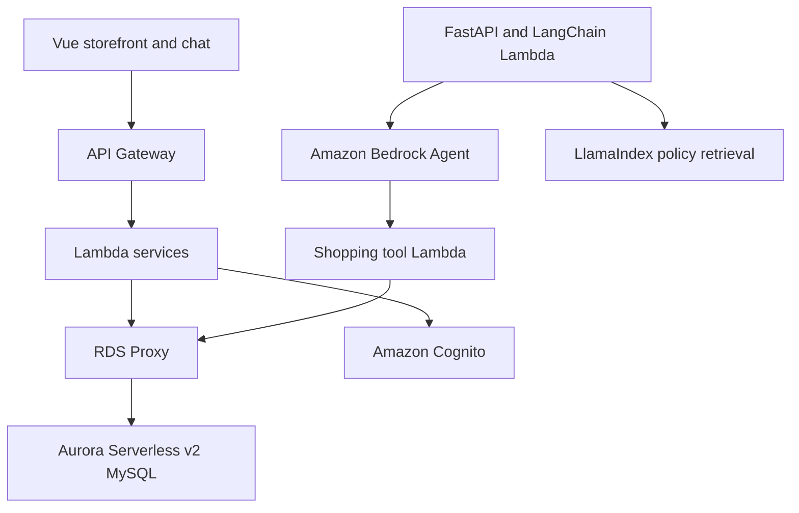

# AWS Serverless MySQL Agentic Shopping Assistant

A sample online store with a Vue interface and an Amazon Bedrock shopping agent. Product, inventory, cart, customer,
and order data are stored in Aurora Serverless v2 MySQL. AWS Lambda reaches MySQL through RDS Proxy using IAM
authentication. The assistant API uses FastAPI, LangChain structured output, and LlamaIndex policy retrieval.

The assistant can search products, check stock, manage a signed-in customer's cart, show order history, summarize
popular products, and create an order after the customer confirms checkout.

## Architecture



| Component | Purpose |
|---|---|
| Vue 2 and AWS Amplify | Storefront, authentication, cart, and chat interface |
| Amazon Cognito | Customer sign-up, sign-in, and API authorization |
| API Gateway and Lambda | Product, cart, checkout, and assistant APIs |
| Aurora Serverless v2 MySQL | Relational commerce data and transactions |
| RDS Proxy | Pooled, TLS-protected Lambda database connections |
| Amazon Bedrock Agents | Conversation and selection of controlled shopping tools |
| FastAPI and Mangum | Typed authenticated `/assistant` API running on Lambda |
| LangChain | Pydantic-validated response formatting through Bedrock Converse |
| LlamaIndex | Keyword retrieval over trusted store policy and FAQ documents |
| DynamoDB | Short-lived binding between a Bedrock session and a Cognito customer |

## MySQL data model

The schema is in `backend/database/schema.sql` and contains:

- `products` and `product_tags`
- `inventory`
- `customers`
- `carts` and `cart_items`
- `orders` and `order_items`

Checkout runs as one database transaction. It locks the cart and inventory rows, validates stock, creates the order,
copies the purchased product details into `order_items`, reduces inventory, and clears the cart. A failure rolls back
the entire operation.

## Shopping-agent tools

| Tool | Behavior |
|---|---|
| `search_products` | Searches the MySQL catalog using typed filters |
| `check_inventory` | Reads current stock for one product |
| `get_cart` | Reads the signed-in customer's cart and total |
| `add_to_cart` | Adds a verified product after confirmation |
| `update_cart_quantity` | Sets or removes a cart item after confirmation |
| `preview_checkout` | Calculates a checkout preview without writing data |
| `confirm_checkout` | Creates the order after explicit confirmation |
| `get_order_history` | Lists only the signed-in customer's recent orders |
| `get_sales_summary` | Returns aggregate product sales without customer data |

The model cannot submit SQL. Each tool calls a fixed function in `backend/layers/mysql_repository.py`, and every value
is passed to MySQL as a parameter. Cognito identity is obtained from the authenticated API or the server-side session
binding, never from model-generated input.

## Structured assistant API

`POST /assistant` accepts `message` and an optional `sessionId`. It keeps the original response fields for frontend
compatibility and adds a typed envelope:

```json
{
  "message": "I found one product.",
  "sessionId": "31f532db-9403-4d11-9667-b4d18c2043dc",
  "responseType": "product_search",
  "products": [{"productId": "p-1", "name": "Apple", "price": 1.25}],
  "cart": null,
  "orders": [],
  "order": null,
  "requiresConfirmation": false,
  "citations": []
}
```

FastAPI validates the request and response models. LlamaIndex retrieves local, version-controlled policy documents;
it is deliberately not used for live commerce data. The existing Bedrock Agent continues to select safe MySQL tools
and enforce confirmation for mutations. LangChain's Bedrock Converse integration converts the final agent answer to a
Pydantic schema. If that formatting call fails, the API returns the original agent answer in a minimal valid envelope.
The API is deployed as a Lambda container image because the combined framework dependency tree is larger than the
unzipped limit for a Lambda `.zip` package; `sam deploy --resolve-image-repos` manages its ECR repository.

## API

Product browsing is public:

- `GET /product`
- `GET /product/{product_id}`

Cart operations require a Cognito ID token:

- `GET /cart`
- `POST /cart`
- `PUT /cart/{product_id}`
- `POST /cart/checkout`
- `GET /cart/{product_id}/total`

The assistant also requires authentication:

- `POST /assistant`

## Deploy to AWS

Requirements:

- AWS CLI configured for your account
- AWS SAM CLI 1.165 or newer
- Docker (the FastAPI/LangChain/LlamaIndex Lambda is packaged as a container image)
- Python 3.13
- Node.js 20
- An Amazon Bedrock model enabled in the deployment region

Clone the repository and deploy all backend stacks:

```bash
git clone https://github.com/AJJAPUSIVA/AWS-Serverless-Shopping-WebSite-App.git
cd AWS-Serverless-Shopping-WebSite-App
make backend
```

The deployment order is authentication, MySQL, product API, cart API, and Bedrock agent. The database stack creates a
private VPC, two private subnets, Aurora Serverless v2, RDS Proxy, security groups, and the initial schema.

Run the frontend locally:

```bash
make frontend-serve
```

Open `http://localhost:8080`, create an account, confirm the email address, and sign in. Cart and assistant actions are
disabled until the user is authenticated.

> Aurora Serverless v2, RDS Proxy, Bedrock, and other AWS services can incur charges. Delete the stacks when the demo
> is no longer needed.

```bash
make backend-delete
```

The Aurora cluster uses snapshot retention during stack deletion. Remove unwanted final snapshots separately from the
RDS console.

## Continuous integration

GitHub Actions is the primary CI system because the project is hosted on GitHub and does not require a separate
Jenkins server. The workflow in `.github/workflows/ci.yml` starts a real MySQL 8.4 service and runs:

- Agent unit tests
- FastAPI schema, session, fallback, and LlamaIndex retrieval tests
- MySQL catalog, cart, inventory, checkout, and order integration tests
- SQL-injection regression coverage
- Python compilation
- SAM and CloudFormation validation
- Frontend lint and production build with Node.js 20
- A check that the patched `sqlparse==0.6.0` is installed

Open the repository's **Actions** page after pushing a branch. Both **Backend, MySQL, and security** and **Frontend**
must pass before merging.

The test commands are ordinary shell commands, so they can be moved into a Jenkins pipeline later if an organization
already operates Jenkins. Maintaining two CI definitions is intentionally avoided for this sample.

## Security choices

- Aurora and RDS Proxy are private and have no public IP address.
- Lambda-to-proxy traffic uses TLS and IAM database authentication.
- Secrets Manager stores the credential used by RDS Proxy to reach Aurora.
- Cart, checkout, order history, and assistant APIs require Cognito authentication.
- Bedrock tool functions accept typed parameters and use parameterized SQL only.
- LangChain output is validated with Pydantic; server-owned session identity and citations are never model-generated.
- LlamaIndex reads only trusted policy files and never queries customer or commerce tables.
- Cart mutations and checkout require agent confirmation.
- CI pins `sqlparse==0.6.0`, and Dependabot monitors Python and frontend dependencies.

## Demo limitations

- Checkout creates an order but does not charge a payment method.
- The seed catalog is intentionally small.
- The Vue 2 frontend is retained to keep the change focused on the data and agent architecture.
- The demo uses one database principal for schema initialization and runtime access; a production deployment should
  create a separate least-privilege runtime user after migrations complete.
- Production deployments should add alarms, database performance monitoring, payment idempotency, and an order
  cancellation/refund workflow.

## License

This project uses the MIT-0 License. See [LICENSE](LICENSE).
